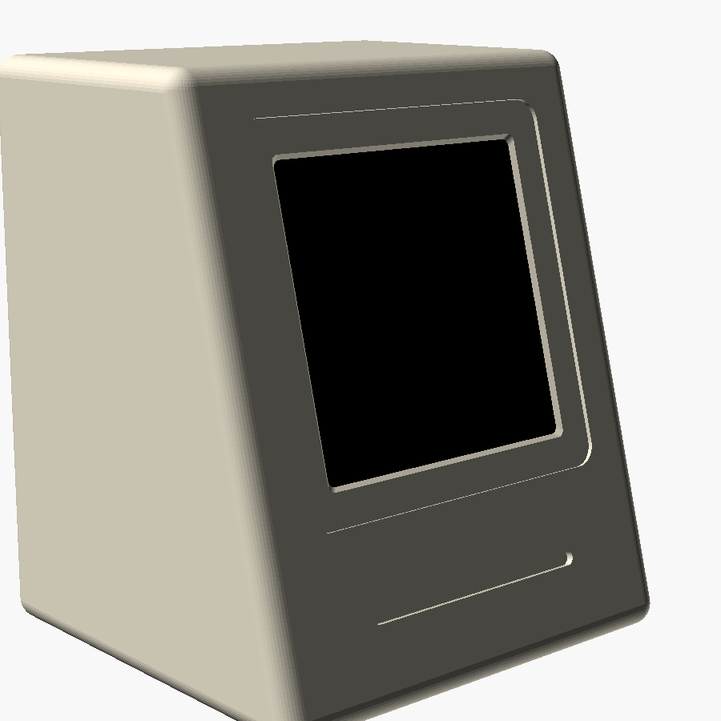
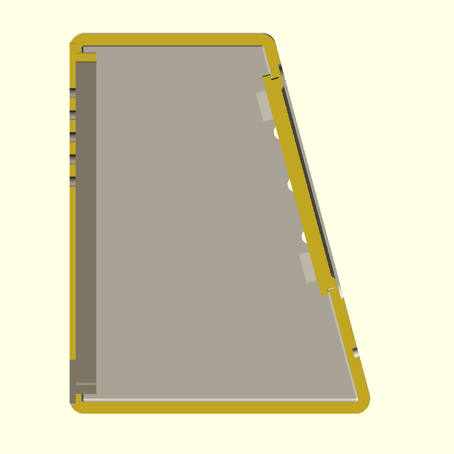

# Retro-PC dock (ESP32-C6-Touch-AMOLED-2.16)

A small tilted Macintosh-style terminal for the Clawdmeter. The display
sits behind a recessed bezel, with a decorative floppy slot under it. The
right-angle USB-C plug stays hidden inside, and the cable leaves through
the back cover.

| Front | Cross-section (front on the right) |
|---|---|
|  |  |

`retro_pc.scad` is fully parametric. Open it in [OpenSCAD](https://openscad.org)
and press F5 to preview, or use the Customizer panel (Window → Customizer)
to change the numbers with sliders.

## 1. Measure your board first

The numbers in the `Board — MEASURE THESE` block are guesses. Measure these
with calipers:

| Parameter | What to measure |
|---|---|
| `board_w`, `board_h` | PCB outline. `board_h` runs from the USB-C edge to the top edge. |
| `glass_w`, `glass_h`, `glass_t` | The display glass/module outline, and how far it stands proud of the PCB front. |
| `glass_dv` | How far the glass centre is above the PCB centre (0 if centred). |
| `active` | Visible pixel area. 480×480 at 2.16″ comes to about 38.8 mm. |
| `buttons` | Each side button: which side, its height above the PCB bottom edge, and its depth behind the PCB front. **The firmware uses all three**: BOOT = Space/voice, KEY = Shift+Tab, PWR = cycle screens / hold to pair. |
| `btn_protrude` | How far the buttons stick out past the PCB edge. |
| `back_parts` | Tallest part on the PCB back (battery connector etc.). |

## 2. Print the fit test

`part = "fit_test"` is just the front few mm of the case. It takes about 20
minutes and checks the window, glass pocket, board fit and button holes.
Adjust and repeat until the board snaps in nicely.

## 3. Print the parts

```bash
openscad -D 'part="body"'       -o body.stl       retro_pc.scad
openscad -D 'part="back_cover"' -o back_cover.stl retro_pc.scad
openscad -D 'part="plunger"'    -o plunger.stl    retro_pc.scad   # print 3
```

- **Body: print face-down.** The STL is already rotated that way. The front
  comes out bed-smooth and the inside needs no support. Printed upright, the
  ceiling would be a ~60 mm unsupported bridge.
- Matte PLA or PETG, 0.16–0.2 mm layers, 3–4 walls, 15–20 % gyroid.
- Stick 4 rubber feet into the recesses underneath.

## 4. Assemble

1. Drop the three plungers into the side holes from the inside, heads inward.
2. Push the board in from the back, display first. It snaps past the four
   side clips and rests against the front lip. If it's too tight, sand the
   clips. If it's too loose, add a dab of hot glue.
3. Plug in the right-angle USB-C, run the cable out through the notch, and
   press the back cover in (friction fit).

Notes:
- PLA doesn't block Bluetooth/Wi-Fi, so the antenna needs no special cut-out.
- With 15° tilt, the IMU auto-rotation still reads the screen as upright.
