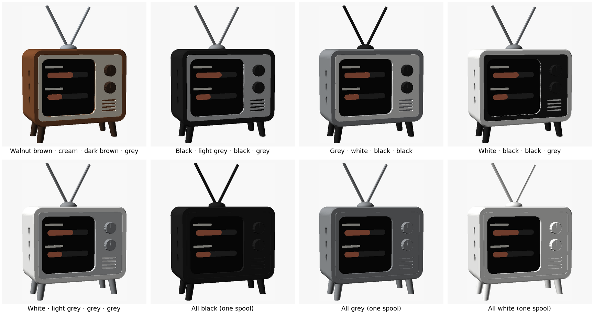

# Printing guide (for whoever prints this)

Ready-to-print files are in [`stl/`](stl/). Every part is already rotated the
way it should lie on the bed, so import it and don't rotate it. All parts
are small (the body is 75 × 56 × 38 mm, about 45 g of PLA in total), so any
printer works.

## Settings (all parts)

| Setting | Value |
|---|---|
| Material | PLA, matte if available (it hides layer lines) |
| Layer height | 0.2 mm (0.16 mm for a finer look) |
| Walls / perimeters | 3 |
| Infill | 15–20 %, any pattern (gyroid is nice) |
| Supports | **off**. Nothing needs them |
| Brim | only for `legs` and `antenna` (small footprints) |
| Scale | 100 %, dimensions are in mm |

## Step 1: fit test (do this first)

| File | Colour | Time (rough) |
|---|---|---|
| `0_fit_test.stl` | any | ~45 min |

This is the front ~15 mm of the case. Push the device in from the back,
screen first, USB-C to the right, buttons on the left. Check:
- it slides in without force and doesn't rattle,
- no white rim shows around the screen,
- the three side holes line up with the buttons.

If anything is off, measure by how much, adjust `retro_tv.scad`, and
re-export (or ask Claude to). Don't print the rest until this fits.

## Step 2: pick a colour scheme, print its plates

Each folder in `stl/` is one colour scheme. Inside it there's **one file per
filament colour**, and each file is one ready plate. Load a file, put that
filament in, print, then do the next file. Every plate fits a 180 × 180 mm bed.

| Folder | Files (= filament colours) | Look |
|---|---|---|
| `1_classic/` | walnut brown, cream, dark brown, grey | 60s wood TV |
| `2_black_grey/` | black, light grey, grey | 70s black set with a silver panel |
| `3_grey_white/` | grey, white, black | bright, high contrast |
| `4_white_black/` | white, black, grey | modern white with a black panel |
| `5_white_grey/` | white, light grey, grey | soft, all light |
| `6_one_colour/` | one file, any single colour | everything in one print |

Schemes 1–5 in the picture's top row and bottom-left; the last three show the
one-colour plate in black, grey and white.

What's on the plates: the body, back cover and 3 button pins are always the
body colour (the pins blend into the TV's side). The front panel, the knobs
+ legs and the antenna go with whichever colour the scheme gives them.

- **Brim:** add one for the legs and the antenna (small footprints). With
  them on the same plate as the body, a brim on everything is fine too.
- **Time:** about 4 h for the body plate, under 1 h for each of the others.
  The single-colour plate takes about 5–6 h.
- **Multi-colour printer (e.g. Bambu AMS)?** Load all files of one scheme
  together as one project, give each object its filament, and print in one go.

Single parts (to reprint just one) are in `stl/parts/`.

## After printing

- Remove brims, and clean the edges of the screen window with a knife if
  needed.
- Tolerances: holes often print a little small. If a peg doesn't go in,
  sand it lightly rather than forcing it.

Assembly steps are in [README.md](README.md#assemble).
