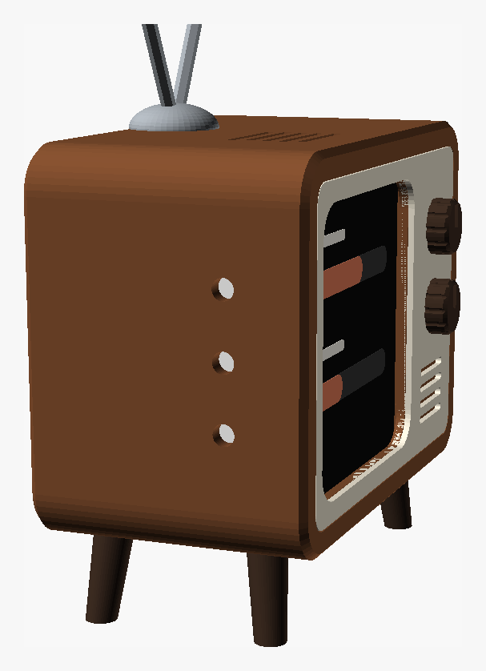

# Retro-TV dock (ESP32-C6-Touch-AMOLED-2.16)

A small 60s-style television that holds the Clawdmeter: the Waveshare
ESP32-C6-Touch-AMOLED-2.16 in its white 45 × 45 × 22 mm shell. The screen
sits on the left behind a rounded TV window. On the right is a control panel
with two knobs and a speaker grille. It stands on four splayed legs, with
rabbit-ear antennas on top.

| Front | Left side (buttons) |
|---|---|
|  |  |

**The device is mounted a quarter turn:** USB-C faces right, the buttons
left, and the speaker up.
- The right-angle plug hides behind the control panel.
- The three buttons are pressed through the left side with printed plungers.
- Slots in the TV's top let the speaker sound out.
- The device's motion sensor (IMU) turns the picture upright by itself. Touch
  needs no change, since a tap anywhere just switches screens.
- The cable leaves the plug heading back, curves round behind the device,
  runs along its back and leaves through the back cover's bottom corner on
  the button side (bottom right seen from behind). The space behind the
  device (`cable_lane`, 16 mm) leaves room for a ~12 mm bend radius, because
  braided cables are too stiff to fold flat against the device's back.

Size: 75 × 56 × 42 mm body. On its legs it stands about 70 mm tall, or about
104 mm to the antenna tips. Run `openscad -D 'part="dims"' -o x.stl retro_tv.scad`
to print the numbers after you change parameters.

`retro_tv.scad` is fully parametric. Open it in [OpenSCAD](https://openscad.org),
press F5 to preview, and use Window → Customizer to change the numbers.

## Measurements used

All measurements are with the device as mounted (USB-C right, buttons left,
speaker up):

| Parameter | Value | Note |
|---|---|---|
| `dev_w` × `dev_h` × `dev_d` | 45 × 45 × 22 mm | the white shell |
| `glass` | 43 mm | 1 mm white rim all round. The window is 42 mm so no white shows. |
| `btn_z` | 12.5 / 22.5 / 32.5 mm | button centres above the device's bottom |
| `btn_protrude` | 1 mm | |
| `btn_y` | 9.5 mm | button centres behind the front edge of the shell |
| `plug_len` | 14 mm | right-angle plug head |

## Print the fit test first

`part="fit_test"` is the front ~14 mm of the case, a short print. Push the
device in from the back and check three things:
- the white rim doesn't show in the window,
- the four corner brackets hold it centred,
- the three button holes line up with the buttons.

## Parts

All STLs come out already in print orientation:
`openscad -D 'part="body"' -o body.stl retro_tv.scad`

| Part | Colour idea | Notes |
|---|---|---|
| `body` | walnut brown | Face-down, no supports. |
| `faceplate` | cream | Glue it into the front recess. This gives the two-tone look without a multi-colour printer. |
| `back_cover` | walnut | Friction fit, with vents. Its two pressers (high up, clear of the cable) hold the device against the front. |
| `knobs` | dark brown | Decorative, pinned with a short stub of 1.75 mm filament. |
| `legs` | dark brown | 4 legs, all the same length at `tilt = 0`. Press-fit or glue. |
| `antenna` | grey | Dome + 2 rods. 2 mm metal rod or a bamboo skewer looks better than printed rods. |
| `plungers` | any | 3, through the left wall. |

Matte PLA, 0.16–0.2 mm layers, 3–4 walls, 15–20 % gyroid.

## Assemble

1. Glue the faceplate in, then pin and glue the knobs.
2. Drop the three plungers into the left-side holes from the inside.
3. Slide the device in from the back: screen first, USB-C to the right,
   buttons to the left, speaker up.
4. Plug in the right-angle USB-C. Curve the cable round behind the device,
   along its back, to the bottom corner on the button side, and lay it into
   the notch.
5. Stick a small felt or rubber pad (1–2 mm) on each presser of the back
   cover, then press the cover on. The pads push the device snugly against
   the front.
6. Press in the legs and the antenna dome.
