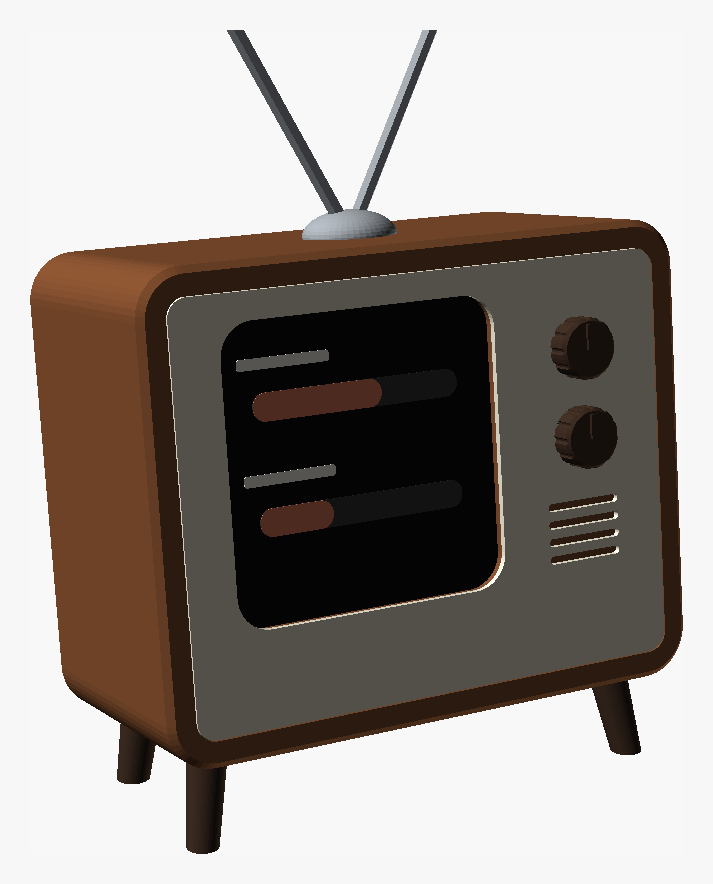
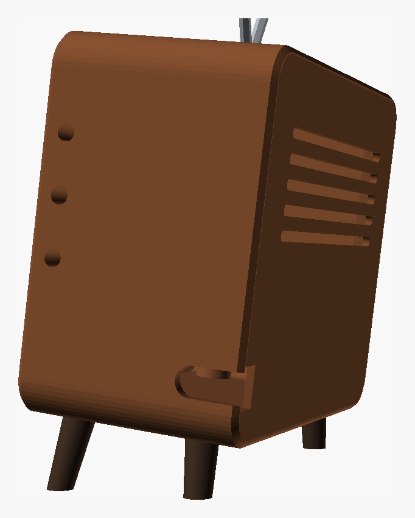

# Retro-TV dock (ESP32-C6-Touch-AMOLED-2.16)

A small 60s-style television for the Clawdmeter. The screen sits on the
left behind a rounded TV window. On the right is a control panel with two
knobs and a speaker grille. Splayed legs (the rear ones are shorter) lean
the screen back 7°, and there are rabbit-ear antennas on top. The
right-angle USB-C plug stays hidden inside, and the cable leaves through a
notch low on the right side near the back.

| Front | Right side (buttons + cable exit) |
|---|---|
|  |  |

`retro_tv.scad` is fully parametric. Open it in [OpenSCAD](https://openscad.org),
press F5 to preview, and use Window → Customizer to change the numbers.

## 1. Measure your board first

The `Board — MEASURE THESE` values are guesses. Measure these with calipers:

| Parameter | What to measure |
|---|---|
| `board_w`, `board_h` | PCB outline. `board_h` runs from the USB-C edge to the top edge. |
| `glass_w`, `glass_h`, `glass_t` | Display glass outline, and how far it stands proud of the PCB. |
| `glass_dv` | Glass centre offset upward from the PCB centre. |
| `buttons` | For each side button: which side, its height above the PCB bottom, and its depth behind the PCB front. The firmware uses all three (BOOT = Space/voice, KEY = Shift+Tab, PWR = cycle screens / hold to pair). |
| `btn_protrude` | How far the buttons stick out past the PCB edge. |

Then print `part="fit_test"` (the front few mm, about 20 min). It checks the
window, how the board clips in, and the button holes before the long print.

## 2. Parts

All STLs come out already in print orientation:
`openscad -D 'part="body"' -o body.stl retro_tv.scad`

| Part | Colour idea | Notes |
|---|---|---|
| `body` | walnut brown | Face-down, no supports. |
| `faceplate` | cream | Glue it into the front recess. This gives the two-tone look without a multi-colour printer. |
| `back_cover` | walnut | Friction fit, with vents in the upper half. |
| `knobs` | dark brown | Decorative, pinned with a 6 mm stub of 1.75 mm filament. |
| `legs` | dark brown | 4 legs: the front pair is longer, which sets the tilt. Press-fit or glue. |
| `antenna` | grey | Dome + 2 rods. 2 mm metal rod or a bamboo skewer looks better than printed rods. |
| `plungers` | any | One per side button. The long ones go through the right control panel. |

Matte PLA, 0.16–0.2 mm layers, 3–4 walls, 15–20 % gyroid. Walnut-brown,
cream and dark-brown PLA all exist, so no painting is needed.

## 3. Assemble

1. Glue the faceplate in, then pin and glue the knobs.
2. Drop the plungers into the side holes from the inside.
3. Push the board in from the back, glass first, until it snaps past the four
   clip posts.
4. Plug in the right-angle USB-C. A sideways (left/right) elbow works best,
   but a back-facing elbow fits too. Route the cable right, then back, and
   out through the notch.
5. Press the back cover on, then press in the legs and the antenna dome.

The 7° tilt is set by `tilt` (and `leg_len`). The IMU auto-rotation still
reads the screen as upright.
